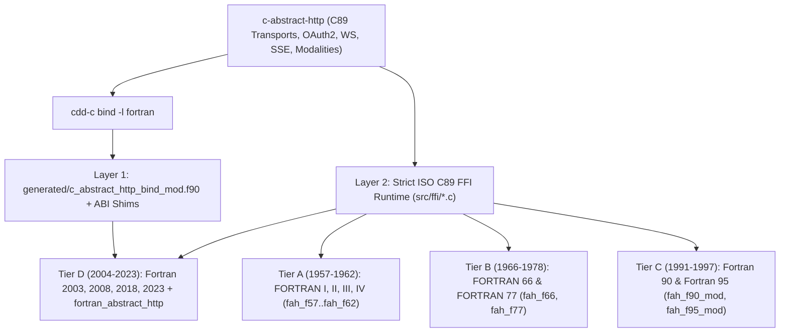

# Architecture of `fortran-abstract-http`

## System Overview

`fortran-abstract-http` bridges [`c-abstract-http`](../c-abstract-http) (strict C89 portable HTTP/1.1–3, OAuth2, WebSockets, SSE, and concurrency runtime) to **all 12 historical and modern specifications of FORTRAN / Fortran (1957–2023)** using [`cdd-c`](../cdd-c) and a layered zero-panic ISO C89 FFI runtime.

---

## Core Design Pillars

### 1. Positive 31-Bit Tagged Generation-Counted Handle Registry (`fah_handle_registry.c`)
Pre-2003 FORTRAN (FORTRAN I through Fortran 95) has no `TYPE(C_PTR)` pointer interoperability. Instead of truncating 64-bit C pointers into 32-bit `INTEGER` variables (which corrupts memory on 64-bit platforms), every C object is registered in a static 4096-slot table returning a **positive 31-bit signed integer** (`fah_handle_t > 0`):
- **Bit 31 (`0`)**: Guarantees `handle > 0` so 1957 FORTRAN (I) 3-way arithmetic `IF (IHNDL) neg, zero, pos` always takes the positive branch on valid handles.
- **Bits 26–30 (5 bits)**: `fah_handle_tag_t` (`1..21`), catching cross-type handle misuse (`FAH_ERR_BAD_HANDLE_TAG`).
- **Bits 17–25 (9 bits)**: Non-zero generation counter (`1..511`), catching use-after-free and double-free deterministically (`FAH_ERR_STALE_HANDLE`).
- **Bits 0–16 (17 bits)**: 1-based slot index (`1..4096`) for $O(1)$ lookup without heap allocation.

### 2. Multi-Era String & Payload Codecs (`fah_hollerith.c`, `fah_f77_strings.c`)
- **FORTRAN I & II (1957–1958)**: Unpacked `INTEGER` ASCII character-code arrays (`1` character per `INTEGER` element) validated against `0..255` (`FAH_ERR_HOLLERITH_DECODE`).
- **FORTRAN III, IV & 66 (1958–1966)**: Packed 4-character-per-32-bit-`INTEGER` Hollerith words (`4HGET `) reading raw storage-unit byte order identically on little-endian and big-endian architectures.
- **FORTRAN 77, Fortran 90 & Fortran 95**: Compiler-independent `CHARACTER*(*)` hidden trailing length (`fah_charlen_t`: `size_t` on modern `gfortran >= 8` / `flang`, or `int` via `-DFAH_LEGACY_INT_CHARLEN=ON` for `f2c` / legacy ABIs).
- **Fortran 2003–2023**: Zero-copy `C_F_POINTER` (`CONTIGUOUS` `INT8(:)` in F2008), TS 29113 `CFI_cdesc_t` descriptors (F2018), and native `F_C_STRING` + deferred-length scalar `CHARACTER(LEN=:), POINTER` views (F2023).

### 3. Strict ISO C89 `CFI_cdesc_t` Descriptor Shim (`fah_cfi_c89.c`)
Fortran 2018 TS 29113 `<ISO_Fortran_binding.h>` uses C99 `<stdint.h>` and flexible array members. To keep 100% of library `.c` files strict ISO C89 (`-std=c89 -pedantic`), `include/fah_cfi_c89.h` defines a layout-identical C89 descriptor (`fah_cfi_cdesc_t`) supporting both zero-copy contiguous arrays and arbitrary-rank strided slices (`mat(1:2, 1:4:2)`), verified at test time by `tests/c/test_abi_layout.c` against the compiler's `<ISO_Fortran_binding.h>`.

### 4. Callback Trampolines & `FahPollQueue` (`fah_callbacks.c`)
- **FORTRAN I–III**: Procedure arguments (`EXTERNAL`) did not exist until 1962 FORTRAN IV. `FahPollQueue` queues HTTP body chunks, WebSocket frames, and SSE events in C FIFO nodes so FORTRAN I–III loops pull events via `IHPQPP` using arithmetic `IF`.
- **FORTRAN IV–2023**: Re-entrant C trampolines invoke Fortran `EXTERNAL` / `BIND(C)` callbacks with integer context IDs (`IUID`), translating non-zero return codes into cooperative `FAH_ERR_CANCELED` termination without unwinding across FFI frames.

### 5. Single Unified Error Enum (`fah_error.h`)
All 19 `c_abstract_http_error_t` codes and 9 FFI-specific failure codes map 1-to-1 into `fah_error_code_t`, accompanied by `fah_error_category_of`, `fah_error_is_retryable`, and `fah_error_format` (`[SYMBOL] op: message`).
